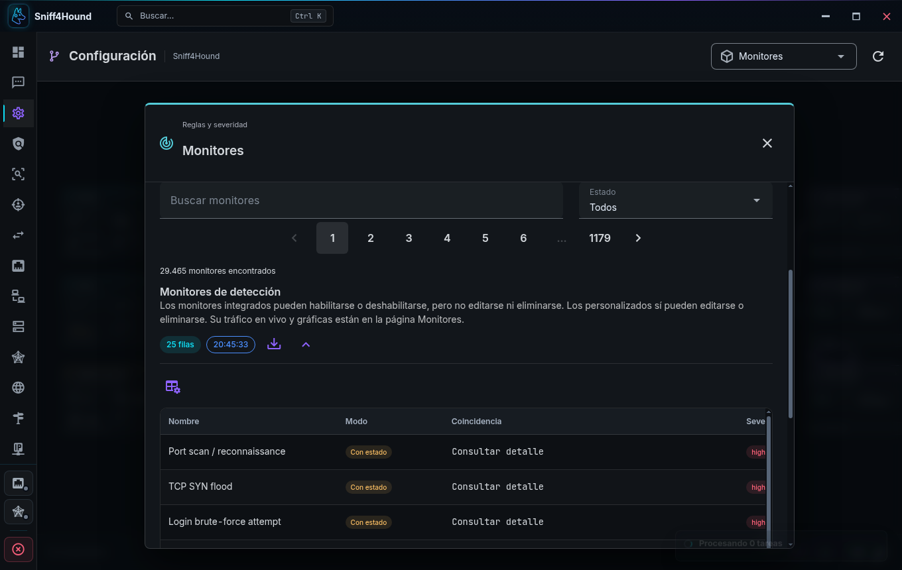
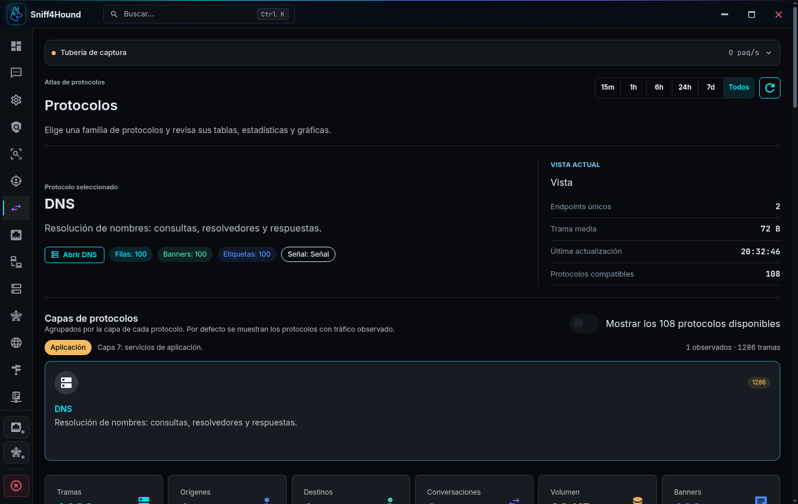
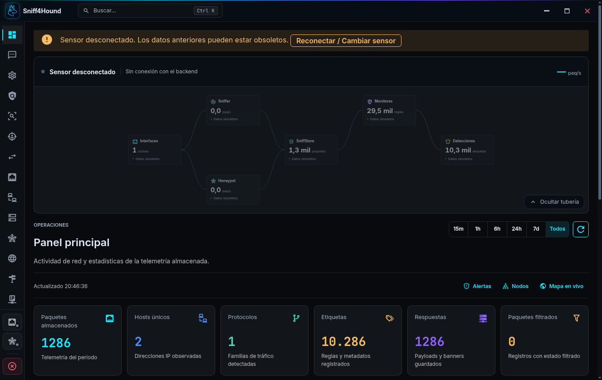

# Verificación de las correcciones de runtime y escritorio

Fecha: 2026-10-17. Rama: `fix/runtime-desktop-qa`, creada desde `origin/main`
actualizado (`84c6f8d`). Se conservaron los cambios locales previos de DNS/ARP,
catálogos offline, mDNS/HTTP3, cierre y elevación con Polkit.

## Validación automática

- Suite completa con un `SNIFF4HOUND_DATA_DIR` temporal:
  `.venv/bin/python -m pytest tests/ -q --disable-warnings --tb=short`:
  **1303 passed, 2 skipped, 413 subtests passed**.
- Después de conservar explícitamente los re-exports de `app.py` usados por
  `views.py`, comprobación final de regresiones y metadatos de protocolos:
  `pytest tests/test_runtime_qa.py tests/test_protocol_catalog_ui.py -q`:
  **26 passed, 32 subtests passed**. Incluye una regresión adicional de esos
  re-exports.
- `cd desktop/frontend && npm test`: lint y los 14 archivos de pruebas pasan.
- `cd desktop/frontend && npm run build`: correcto.
- `python3 scripts/check_test_shards.py`: los 56 módulos están registrados.
- Pyflakes sin diagnósticos en `store.py`, `app.py`, `manage.py`, `sniffer.py` y
  `honeypot.py`; `git diff --check` correcto.

`tests/test_runtime_qa.py` cubre la exclusión TCP/UDP antes del parser y de la
cola (Ethernet, VLAN e IPv6), el puerto de fallback, estados SYN/SYN-ACK/RST,
DNS y atribución de servicios, catálogos paginados, trazas opt-in, propiedad de
logs nuevos y rotados, interfaces móviles, flush sin TTY, origen de la shell
remota, credenciales válidas tras bloqueo y validación de entradas.

Las regresiones de frontend comprueban datos pendientes/obsoletos, mensajes del
bridge, reconexión, búsquedas y páginas de catálogos, detalle de reglas,
selección del protocolo con más tráfico usando el normalizador real,
ubicaciones no declaradas, formato español y configuración de seguridad. La
paleta tiene casos específicos para `arp` y `mapa`.

## Electron real, sensor remoto TLS

Se ejecutó el bundle de producción con `npm run dev -- --ozone-platform=x11
--disable-gpu`, dentro de Xvfb y con `WAYLAND_DISPLAY` eliminado,
`XDG_SESSION_TYPE=x11`, `SNIFF4HOUND_DESKTOP_ELEVATE=0`, datos/configuración
separados y CDP opt-in en 9241. No se abrieron diálogos de Polkit.

El servidor utilizó el API y motores reales, TLS y un listener HTTP/3, con
`SNIFF4HOUND_DESKTOP=0`. Su entrada de captura se sustituyó por frames DNS
sintéticos a 2 paquetes/s, sin sockets AF_PACKET ni tráfico del operador. La
conexión de Electron usó un hostname no-loopback y su CA, pasando por el bridge.

Comprobaciones realizadas:

- POST autenticados de la shell aceptados; sniffer iniciado desde su botón.
- Canal en vivo activo y WebSocket nativo `wss://…/ws/` conectado con ticket.
- Más de cinco minutos de ejecución: 1286 paquetes sintéticos; el botón detuvo
  el motor y permaneció apagado.
- Monitores: 29.465 reglas totales, 25 filas por página. La búsqueda `dns`
  devuelve 902 coincidencias sin descargar el catálogo completo.
- Protocolos: aterriza en DNS y carga 100 filas; respeta una selección explícita.
- CSP limitada al runtime, preload funcionando con sandbox y sin advertencias
  de CSP en la sesión final.
- Al detener el backend de prueba, todos los nodos muestran **Datos obsoletos**;
  aparece **Reconectar / Cambiar sensor** y el botón vuelve al selector.

Mediciones por el bridge real de Electron, con el motor sintético activo:

| Petición | Resultado | Tamaño | Tiempo observado |
| --- | --- | ---: | ---: |
| Monitores, `limit=25&metadata=1` | 200, 25/29.465 | 10.180 bytes | 96 ms |
| Listeners, `limit=25&metadata=1` | 200, 25/10.134 | 5.496 bytes | 7 ms |
| Runtime | 200, motor activo | 1.974 bytes | 5 ms |
| Snapshot DNS, `limit=100` | 200 | 292.014 bytes | 36 ms |

Una muestra de CPU de dos segundos del backend aislado dio 4,5 % y RSS de
774.264 KiB (aprox. 756 MiB). Estas mediciones describen esa ejecución sintética;
no sustituyen la prueba del sensor local con captura real.







## Pendiente por acuerdo con el operador

El operador indicó continuar sin root y documentar la validación pendiente.
`sudo -n` requiere contraseña. Por tanto, **no se ejecutó** la prueba local de
más de cinco minutos con AF_PACKET, interfaz real y UI abierta. Queda pendiente
confirmar en ese escenario CPU/RSS estables, API por debajo de un segundo,
parada desde el botón y carga de Monitores, incluyendo el fallback de puerto.
Los tests y el escenario remoto no demuestran por sí solos ese resultado.

Tampoco se borró el directorio root indicado en el informe original:

```text
/tmp/claude-1000/-home-jlhack-Documents-Project-Sniff4Hound/4fbd14d9-a267-449e-944c-92c7d110ecd6/scratchpad/data2
```

Su eliminación requiere una sesión root autenticada. Todas las ventanas y el
backend de esta verificación se cierran al terminar; no se modifica una sesión
del operador.
